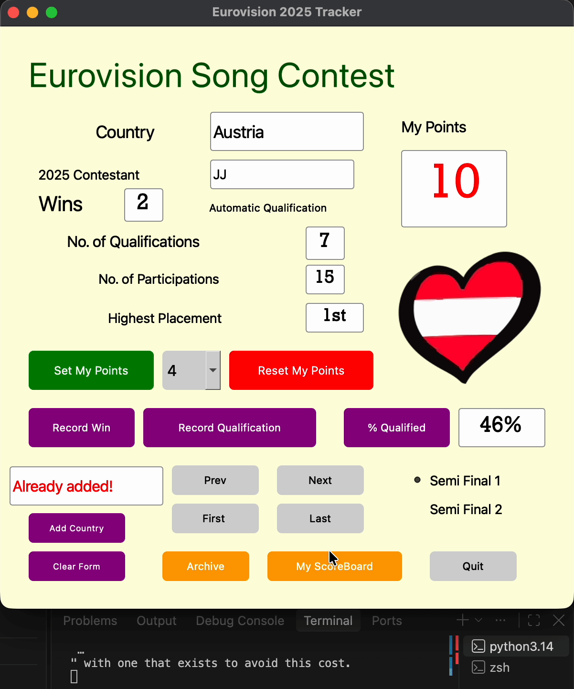

# Eurovision 2025 Tracker

A Python/PyQt5 desktop app for browsing the Eurovision Song Contest 2025 entries and casting your own 1–12 point votes, then saving your personal scoreboard.

Built in Year 2, Semester 2 of my BSc (Hons) Software Design with AI for Cloud Computing at TUS, to practise object-oriented programming, GUI design and file handling in Python.



## Features

- **Browse all 37 entries** with First / Prev / Next / Last navigation: country, 2025 act, total wins, highest placement, participations, qualifications and semi-final.
- **Vote like a Eurovision jury**: give 12, 10, 8, 7 … 1 points. Each score can only go to one country, so giving it again moves it.
- **Generate your scoreboard**: once all ten scores are used, *My ScoreBoard* writes a formatted ranking to `scoreBoard.txt`.
- **Track history**: record a win or a qualification and calculate a country's qualification rate.
- **Add new countries** with input validation: a custom `CountryInputError` rejects missing or non-numeric values and duplicate countries.
- **Save your changes**: *Archive* writes all country data back to `countryFile.txt`, which is loaded at start-up.

## Tech

- Python 3, PyQt5 (layout started in Qt Designer, logic written by hand)
- OOP: `Country` class with encapsulated attributes, and a `RatedCountry` subclass for voted countries
- Custom exceptions for input validation and scoreboard rules
- Plain-text file persistence (colon-separated records, UTF-8)

## Run it

```bash
git clone https://github.com/veronica-tes06/eurovision-tracker.git
cd eurovision-tracker
pip install -r requirements.txt
python ESC_gui.py
```

## Example scoreboard

```
==============================================================
| My Eurovision Scoreboard                                   |
==============================================================
| Points | Country              | Contestant                 |
==============================================================
| 12     | Ireland              | EMMY                       |
| 10     | Albania              | Shkodra Elektronike        |
| 8      | Australia            | Go-Jo                      |
...
```

## Data notes

Participation and qualification counts cover the semi-final era (2004–2025). Wins and highest placement cover the contest's full history.

## What I'd improve next

- Pop-up messages for errors instead of a text field
- Store the data in JSON or SQLite instead of a text file